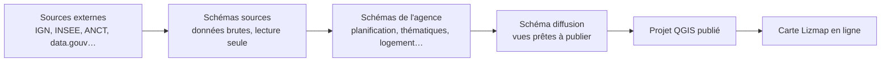
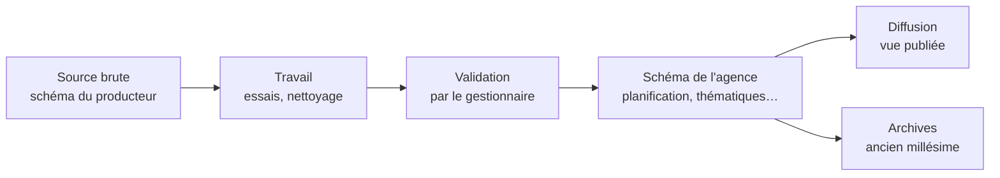
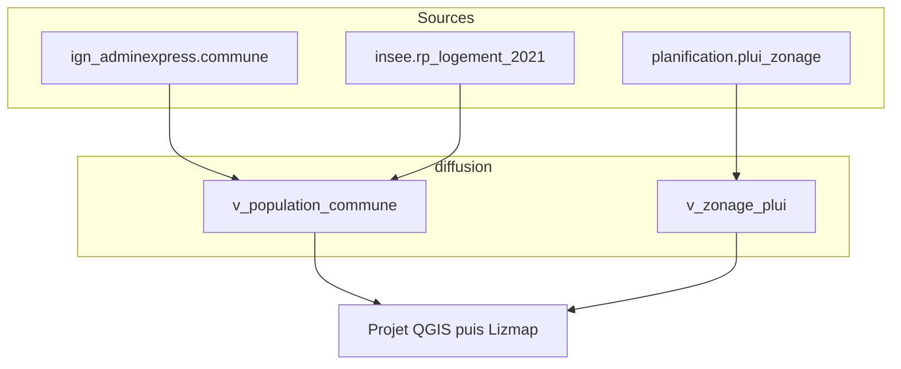
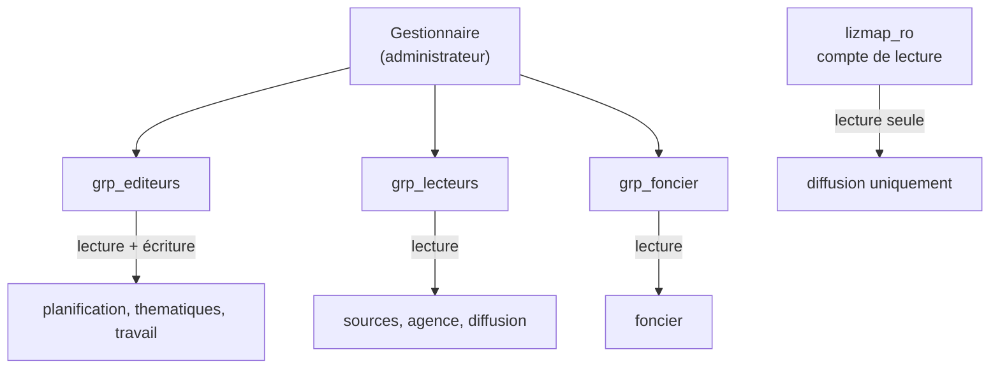
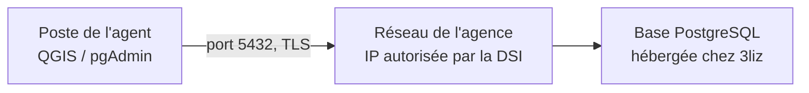
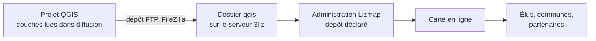
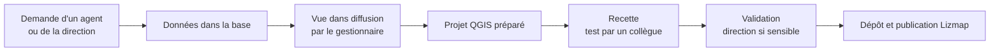
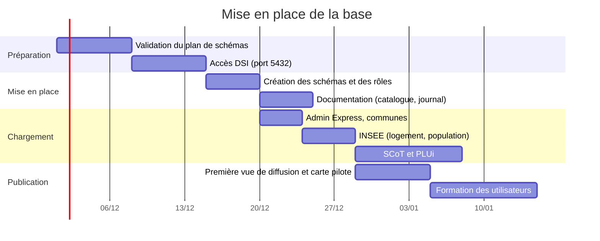

# Guide de structuration de la base de données PostgreSQL/PostGIS de l'AUDC

**Projet** : passage à Lizmap Cloud (3liz, offre Standard) et base de données partagée

**Public** : gestionnaire principal de la base, futurs gestionnaires suppléants, équipe SIG

**Version** : 1.0 – novembre 2026 (document de travail, à faire évoluer)

> Ce guide propose une structure **de départ** : schémas, règles de nommage, droits, méthodes de chargement, publication dans Lizmap, volumétrie, sauvegardes et gouvernance. Les points marqués **« À confirmer »** dépendent d'informations que seul 3liz ou la DSI peut donner.

---

## 1. Ce que l'offre permet et ne permet pas

D'après la proposition de 3liz (n° 261120_0014) et l'échange avec leur équipe :

| Élément | Ce qui est prévu |
|---|---|
| Applications Lizmap | Jusqu'à 2 |
| Bases PostgreSQL/PostGIS | Jusqu'à 2, sur un serveur PostgreSQL dédié |
| Serveur QGIS | 1, dédié (version 3.44) |
| Stockage | 100 Go, **partagés** entre les fichiers de projets QGIS et les bases |
| Création dans la base | Schémas, tables, vues, requêtes : oui. **Création d'une nouvelle base : non** |
| Utilisateurs et groupes | Gérés dans le Cloud Manager de 3liz ; rôles et droits gérés aussi dans pgAdmin |
| Sauvegarde | Export `pg_dump` chaque soir par 3liz ; restauration sur demande |
| Sécurité | Échanges chiffrés ; accès à la base limité aux adresses IP autorisées (port 5432) |
| Sortie du service | Un zip de tous les projets QGIS et un zip de toutes les données |

**Extensions PostgreSQL disponibles par défaut** : `postgis`, `postgis_topology`, `fuzzystrmatch`, `hstore`, `pg_trgm`, `plpgsql`, `tablefunc`, `unaccent`, `uuid-ossp`.
**Plugins du serveur QGIS** : `lizmap`, `wfsOutputExtension`, `AtlasPrint`.

> Utiles pour nous : `unaccent` et `pg_trgm` (recherche de communes ou de noms de rues sans tenir compte des accents ni des fautes de frappe), `uuid-ossp` (identifiants uniques), `tablefunc` (tableaux croisés).
> Extensions supplémentaires (par exemple `pgrouting` ou `postgis_raster`) : options payantes chez 3liz.

### Que faire des deux bases autorisées ?

| Base | Usage recommandé |
|---|---|
| `audc_prod` | Production : données validées, lues par Lizmap |
| `audc_test` | Bac à sable : essais d'import, de nouvelles structures, de formations |

> **À confirmer** : le nom, la création et les droits de ces deux bases (3liz les fournit) ; savoir si la seconde base compte dans les 100 Go (oui, probablement).

---

## 2. Principes d'organisation

### 2.1 Trois couches



| Couche | Rôle | Qui écrit ? |
|---|---|---|
| **Sources** | Garder les données telles que le producteur les livre | Le gestionnaire uniquement |
| **Agence** | Données produites, enrichies ou croisées par l'équipe | Le gestionnaire et les éditeurs |
| **Diffusion** | Ce qui est montré dans les cartes en ligne | Le gestionnaire uniquement |

### 2.2 Les cinq règles d'or

1. **Un schéma par producteur** pour les données brutes (IGN, INSEE, ANCT…) : on sait d'où vient chaque donnée.
2. **On ne modifie jamais une donnée source.** Si on la corrige ou l'enrichit, on crée une nouvelle table dans un schéma de l'agence.
3. **Lizmap ne lit que le schéma `diffusion`.** Jamais les sources brutes ni le schéma de travail.
4. **Une donnée n'existe qu'une fois.** Si deux cartes ont besoin de la même couche, elles lisent la même table ou la même vue.
5. **Tout est documenté.** Chaque schéma et chaque table porte un commentaire et figure dans le catalogue (`meta.catalogue`).

### 2.3 Cycle de vie d'une donnée



---

## 3. Arborescence des schémas

```
base « audc_prod »
│
├── SOURCES (données brutes, lecture seule)
│   ├── ign_bdtopo           IGN – BD TOPO (bâti, routes, eau, végétation…)
│   ├── ign_adminexpress     IGN – limites administratives
│   ├── insee                INSEE – recensement, populations légales, Filosofi
│   ├── anct                 ANCT – QPV, dispositifs territoriaux
│   ├── datagouv             Jeux de données isolés de data.gouv.fr
│   └── logement             Données habitat (RPLS, Sitadel, DVF, LOVAC…) *
│
├── DONNÉES SENSIBLES (accès restreint)
│   └── foncier              Fichiers fonciers, parcellaire propriétaires
│
├── AGENCE (ce que nous produisons)
│   ├── planification        SCoT, PLUi : zonage, prescriptions, servitudes
│   ├── thematiques          études de l'agence : économie, mobilité, environnement…
│   └── travail              espace d'essai par agent, à nettoyer régulièrement
│
├── PUBLICATION
│   └── diffusion            vues lues par Lizmap (lecture seule)
│
└── GESTION
    ├── archives             anciens millésimes
    └── meta                 catalogue des données, journal des imports, nomenclatures
```

\* `logement` : voir la remarque en 4.6.

### Tableau de synthèse

| Schéma | Type | Écriture | Lecture | Mise à jour | Lu par Lizmap |
|---|---|---|---|---|---|
| `ign_bdtopo` | Source | Gestionnaire | Tous les agents | Trimestrielle | Non |
| `ign_adminexpress` | Source | Gestionnaire | Tous | Annuelle | Non |
| `insee` | Source | Gestionnaire | Tous | Annuelle | Non |
| `anct` | Source | Gestionnaire | Tous | Selon publication | Non |
| `datagouv` | Source | Gestionnaire | Tous | Au cas par cas | Non |
| `logement` | Source/thème | Gestionnaire | Tous | Annuelle | Non |
| `foncier` | Source sensible | Gestionnaire | Groupe restreint | Annuelle | Non |
| `planification` | Agence | Gestionnaire, éditeurs | Tous | Au fil de l'eau | Non |
| `thematiques` | Agence | Gestionnaire, éditeurs | Tous | Selon les études | Non |
| `travail` | Agence | Tous les éditeurs | Propriétaire de la table | Libre | Non |
| `diffusion` | Publication | Gestionnaire | Tous + compte Lizmap | À chaque publication | **Oui** |
| `archives` | Gestion | Gestionnaire | Tous | À chaque millésime | Non |
| `meta` | Gestion | Gestionnaire | Tous | À chaque import | Non |

---

## 4. Détail de chaque schéma

### 4.1 `ign_bdtopo` – IGN BD TOPO

- **Contenu** : bâtiments, tronçons de route, cours d'eau, zones de végétation, équipements, zones d'activité, etc.
- **Nommage des tables** : comme chez le producteur, en minuscules (`batiment`, `troncon_de_route`, `cours_d_eau`).
- **Attention au volume** : la BD TOPO est très volumineuse. Ne chargez que le département de la Marne et les départements voisins si nécessaire.
- **Millésime** : colonne `millesime` ou suffixe sur la table si vous gardez plusieurs versions.

### 4.2 `ign_adminexpress` – IGN Admin Express

- **Contenu** : communes, EPCI, arrondissements, départements, régions.
- **Rôle clé** : sert de référence pour tous les croisements avec l'INSEE (jointure par code INSEE commune).
- **Conseil** : conserver le code INSEE commune en **texte sur 5 caractères** (`'51454'`, jamais un nombre, pour garder les zéros).

### 4.3 `insee` – INSEE

- **Contenu** : populations légales, recensement (population, logement, activité, emploi), Filosofi (revenus), séries historiques.
- **Particularité** : ce sont des tables **sans géométrie**. On les relie aux communes d'Admin Express par le code INSEE.
- **Nommage conseillé** : `rp_logement_2021`, `pop_legale_2022`, `filosofi_commune_2020`.

### 4.4 `anct` – Agence nationale de la cohésion des territoires

- **Contenu** : quartiers prioritaires de la politique de la ville (QPV), programmes territoriaux (Action cœur de ville, Petites villes de demain, ORT…), zonages.
- **Conseil** : noter dans le catalogue la date de publication du zonage, car il évolue.

### 4.5 `datagouv` – data.gouv.fr

- **Attention** : data.gouv.fr est une **plateforme**, pas un producteur. Ce schéma risque de devenir un fourre-tout.
- **Règle proposée** : on n'y met que des jeux de données isolés. Chaque table est préfixée par le producteur réel :
  - `dgfip_dvf_mutations`
  - `sdes_sitadel_permis`
  - `ademe_dpe_logements`
- **Alternative** : créer un schéma au nom du producteur quand il fournit plusieurs jeux (par exemple `dgfip`).

### 4.6 `logement` – données habitat

C'est le schéma le plus délicat, car il mélange des sources de producteurs différents et de l'analyse produite par l'agence.

| Option | Principe | Avantage | Inconvénient |
|---|---|---|---|
| **A (recommandée)** | Un schéma `logement` ; chaque table est préfixée par sa source | Simple pour l'équipe habitat | Mélange sources et analyses |
| B | Données brutes dans les schémas des producteurs (`dgfip`, `sdes`…) ; analyses dans `thematiques` | Très propre | Plus de schémas, plus de rigueur |

**Option A, exemple de tables** :

```
logement.rpls_logement_social_2024     (SDES – répertoire des logements sociaux)
logement.sitadel_permis_2024           (SDES – permis de construire)
logement.dvf_mutations_2024            (DGFiP – valeurs foncières)
logement.lovac_logements_vacants_2024  (fichier des logements vacants)
logement.indicateur_vacance_commune    (analyse produite par l'agence)
```

> **À vérifier** : les conditions d'accès et de diffusion de certains fichiers (logements vacants, fichiers fonciers) : ils ne se diffusent pas librement. Une table sensible va dans `foncier`, pas dans `logement`.

### 4.7 `foncier` – données sensibles

- **Contenu** : Fichiers fonciers (informations sur les propriétaires), parcellaire croisé avec des données personnelles.
- **Accès** : groupe restreint (`grp_foncier`), validé par le directeur et conforme à la convention d'accès aux données.
- **Règle** : ne jamais publier directement. Dans `diffusion`, on ne place qu'une vue **déjà anonymisée ou agrégée** (par exemple au niveau commune ou section).

### 4.8 `planification` – SCoT et PLUi

- **Contenu** : zonage, prescriptions, servitudes, périmètres, emplacements réservés, par document.
- **Nommage conseillé** : `plui_<nom_epci>_zonage`, `scot_perimetre`, `plui_<nom_epci>_prescription_surf`.
- **Millésime** : un champ `date_approbation` ou `version` dans la table. Un ancien état va dans `archives`.

### 4.9 `thematiques` – études de l'agence

- **Contenu** : données produites par l'agence : économie, mobilité, environnement, équipements, démographie.
- **Sous-organisation** : préfixer par le thème (`eco_`, `mob_`, `env_`, `eqt_`, `demo_`).

### 4.10 `travail` – espace d'essai

- **Contenu** : tests, extractions temporaires, brouillons.
- **Règles** :
  - préfixer chaque table par les initiales de l'agent : `ab_essai_zonage` ;
  - rien dans `travail` ne doit être publié ni cité dans un rapport ;
  - **nettoyage mensuel** : les tables non modifiées depuis plus de 60 jours sont supprimées après avertissement.

### 4.11 `diffusion` – vues pour Lizmap

- **Contenu** : uniquement des **vues** (ou vues matérialisées) qui présentent les données prêtes à l'affichage.
- **Nommage** : `v_<theme>_<objet>` pour une vue, `mv_<theme>_<objet>` pour une vue matérialisée.
- **Pourquoi des vues ?** Elles filtrent, renomment les colonnes en langage lisible, masquent les champs inutiles ou sensibles, et protègent les données sources.



### 4.12 `archives` et `meta`

- **`archives`** : anciens millésimes, nommés `<table>_<annee>` (par exemple `plui_zonage_2023`). Surveillez le volume : exportez les archives anciennes hors de la base si besoin.
- **`meta`** : catalogue des données, journal des imports, nomenclatures partagées (voir le chapitre 12).

---

## 5. Règles de nommage et de qualité

### 5.1 Nommage

| Élément | Règle | Exemple |
|---|---|---|
| Schémas | minuscules, sans accent, producteur ou thème | `ign_bdtopo`, `planification` |
| Tables | minuscules, `snake_case`, sans accent ni espace | `plui_zonage`, `rp_logement_2021` |
| Vues | préfixe `v_` | `v_zonage_plui` |
| Vues matérialisées | préfixe `mv_` | `mv_batiment_marne` |
| Colonnes | minuscules, `snake_case`, sans accent | `code_insee`, `date_approbation` |
| Géométrie | toujours `geom` | `geom` |
| Clé primaire | toujours `id` (ou clé naturelle justifiée) | `id` |
| Code INSEE commune | texte sur 5 caractères | `insee_com` |
| Millésime | colonne `millesime` ou suffixe `_2024` | `rp_2021` |

**À éviter** : accents, espaces, majuscules, tirets, noms de plus de 40 caractères, `final`, `v2`, `copie`, `nouveau`.

### 5.2 Projection

**Tout est en EPSG:2154 (Lambert-93)**, sauf justification documentée. Si une source arrive dans une autre projection, on la reprojette à l'import.

```sql
-- Vérifier la projection d'une table
SELECT f_table_schema, f_table_name, srid, type
FROM geometry_columns
ORDER BY f_table_schema, f_table_name;
```

### 5.3 Qualité minimale de chaque table

- une **clé primaire** ;
- un **index spatial** sur la géométrie ;
- une **géométrie valide** ;
- un **type de géométrie cohérent** (tout en multi-polygones, par exemple) ;
- un **commentaire** décrivant la table ;
- une ligne dans `meta.catalogue`.

```sql
-- Index spatial
CREATE INDEX IF NOT EXISTS idx_plui_zonage_geom
  ON planification.plui_zonage USING gist (geom);

-- Clé primaire (si absente)
ALTER TABLE planification.plui_zonage ADD PRIMARY KEY (id);

-- Commentaire
COMMENT ON TABLE planification.plui_zonage IS
  'PLUi – zonage. Source : prestataire X. Date d''approbation : 2024-03-12. Resp. : Abdou.';

-- Contrôle des géométries invalides
SELECT id, ST_IsValidReason(geom)
FROM planification.plui_zonage
WHERE NOT ST_IsValid(geom);

-- Réparation
UPDATE planification.plui_zonage
SET geom = ST_MakeValid(geom)
WHERE NOT ST_IsValid(geom);

-- Mise à jour des statistiques (après un gros import)
VACUUM ANALYZE planification.plui_zonage;
```

---

## 6. Rôles et droits

### 6.1 Principe

On donne les droits à des **groupes**, jamais directement à des personnes. Une personne arrive ou part : on l'ajoute ou on la retire d'un groupe.



### 6.2 Matrice des droits

| Groupe | Sources | `foncier` | `planification`, `thematiques` | `travail` | `diffusion` | `archives`, `meta` |
|---|---|---|---|---|---|---|
| Gestionnaire | Tout | Tout | Tout | Tout | Tout | Tout |
| `grp_editeurs` | Lecture | – | Lecture + écriture | Lecture + écriture | Lecture | Lecture |
| `grp_lecteurs` | Lecture | – | Lecture | – | Lecture | Lecture |
| `grp_foncier` | – | Lecture | – | – | – | – |
| `lizmap_ro` | – | – | – | – | **Lecture seule** | – |

> **Règle de sécurité** : le projet QGIS publié sur Lizmap utilise **uniquement** le compte `lizmap_ro`. Le compte administrateur ne figure jamais dans un projet partagé.

### 6.3 Script SQL de création des schémas

```sql
-- À exécuter avec le compte administrateur, d'abord sur audc_test.
DO $$
DECLARE s text;
BEGIN
  FOREACH s IN ARRAY ARRAY[
    'ign_bdtopo','ign_adminexpress','insee','anct','datagouv','logement',
    'foncier','planification','thematiques','travail','diffusion','archives','meta'
  ]
  LOOP
    EXECUTE format('CREATE SCHEMA IF NOT EXISTS %I', s);
  END LOOP;
END $$;

COMMENT ON SCHEMA ign_bdtopo       IS 'IGN – BD TOPO (extrait Marne et départements voisins)';
COMMENT ON SCHEMA ign_adminexpress IS 'IGN – Admin Express (limites administratives)';
COMMENT ON SCHEMA insee            IS 'INSEE – recensement, populations légales, Filosofi';
COMMENT ON SCHEMA anct             IS 'ANCT – QPV et dispositifs territoriaux';
COMMENT ON SCHEMA datagouv         IS 'data.gouv.fr – jeux isolés, tables préfixées par le producteur';
COMMENT ON SCHEMA logement         IS 'Habitat – tables préfixées par la source (rpls_, sitadel_, dvf_)';
COMMENT ON SCHEMA foncier          IS 'Fichiers fonciers – accès restreint';
COMMENT ON SCHEMA planification    IS 'SCoT et PLUi – zonage, prescriptions, servitudes';
COMMENT ON SCHEMA thematiques      IS 'Études de l''agence';
COMMENT ON SCHEMA travail          IS 'Espace d''essai – nettoyé chaque mois';
COMMENT ON SCHEMA diffusion        IS 'Vues publiées dans Lizmap – lecture seule';
COMMENT ON SCHEMA archives         IS 'Anciens millésimes';
COMMENT ON SCHEMA meta             IS 'Catalogue, journal des imports, nomenclatures';
```

### 6.4 Script SQL des groupes et des droits

> **À confirmer** : 3liz crée peut-être les groupes et utilisateurs via le Cloud Manager, et le compte administrateur n'a peut-être pas le droit `CREATE ROLE`. Testez d'abord ; sinon, demandez à 3liz de créer les rôles ci-dessous.

```sql
-- Groupes (sans connexion)
CREATE ROLE grp_lecteurs NOLOGIN;
CREATE ROLE grp_editeurs NOLOGIN;
CREATE ROLE grp_foncier  NOLOGIN;

-- Compte de lecture pour Lizmap (connexion autorisée) : mot de passe fort via le Cloud Manager
CREATE ROLE lizmap_ro LOGIN PASSWORD 'À_REMPLACER';

-- Ajouter une personne dans un groupe
GRANT grp_editeurs TO prenom_nom;
```

```sql
-- SOURCES : lecture seule pour tous les agents
DO $$
DECLARE s text;
BEGIN
  FOREACH s IN ARRAY ARRAY['ign_bdtopo','ign_adminexpress','insee','anct','datagouv','logement','archives','meta']
  LOOP
    EXECUTE format('GRANT USAGE ON SCHEMA %I TO grp_lecteurs, grp_editeurs', s);
    EXECUTE format('GRANT SELECT ON ALL TABLES IN SCHEMA %I TO grp_lecteurs, grp_editeurs', s);
    EXECUTE format('ALTER DEFAULT PRIVILEGES IN SCHEMA %I GRANT SELECT ON TABLES TO grp_lecteurs, grp_editeurs', s);
  END LOOP;
END $$;

-- AGENCE : lecture pour tous, écriture pour les éditeurs
DO $$
DECLARE s text;
BEGIN
  FOREACH s IN ARRAY ARRAY['planification','thematiques']
  LOOP
    EXECUTE format('GRANT USAGE ON SCHEMA %I TO grp_lecteurs, grp_editeurs', s);
    EXECUTE format('GRANT SELECT ON ALL TABLES IN SCHEMA %I TO grp_lecteurs', s);
    EXECUTE format('GRANT SELECT, INSERT, UPDATE, DELETE ON ALL TABLES IN SCHEMA %I TO grp_editeurs', s);
    EXECUTE format('ALTER DEFAULT PRIVILEGES IN SCHEMA %I GRANT SELECT ON TABLES TO grp_lecteurs', s);
    EXECUTE format('ALTER DEFAULT PRIVILEGES IN SCHEMA %I GRANT SELECT, INSERT, UPDATE, DELETE ON TABLES TO grp_editeurs', s);
  END LOOP;
END $$;

-- TRAVAIL : les éditeurs créent et gèrent leurs tables
GRANT USAGE, CREATE ON SCHEMA travail TO grp_editeurs;

-- FONCIER : groupe restreint
GRANT USAGE ON SCHEMA foncier TO grp_foncier;
GRANT SELECT ON ALL TABLES IN SCHEMA foncier TO grp_foncier;
ALTER DEFAULT PRIVILEGES IN SCHEMA foncier GRANT SELECT ON TABLES TO grp_foncier;

-- DIFFUSION : lecture pour tous et pour le compte Lizmap
GRANT USAGE ON SCHEMA diffusion TO grp_lecteurs, grp_editeurs, lizmap_ro;
GRANT SELECT ON ALL TABLES IN SCHEMA diffusion TO grp_lecteurs, grp_editeurs, lizmap_ro;
ALTER DEFAULT PRIVILEGES IN SCHEMA diffusion GRANT SELECT ON TABLES TO grp_lecteurs, grp_editeurs, lizmap_ro;
```

> **Subtilité importante** : `ALTER DEFAULT PRIVILEGES` ne s'applique qu'aux objets créés **par le rôle qui exécute la commande**. Créez toujours vos tables avec le même compte administrateur, ou ajoutez `FOR ROLE <compte>` dans la commande.
> **Autre point** : les vues de `diffusion` lisent les tables sources avec **les droits de leur propriétaire**. Le compte `lizmap_ro` n'a donc pas besoin d'accéder aux sources, ce qui est justement le but.

---

## 7. Charger les données

### 7.1 Préparer la connexion

La base est accessible depuis le réseau de l'agence une fois que la DSI a autorisé l'adresse IP sur le port **5432**.



**Fichier de service PostgreSQL** (`pg_service.conf`) : une même connexion nommée pour tous les outils (QGIS, pgAdmin, ogr2ogr).

```ini
[audc_prod]
host=<adresse_fournie_par_3liz>
port=5432
dbname=<nom_de_la_base>
user=<identifiant>
sslmode=require
```

Le mot de passe ne s'écrit pas dans ce fichier : utilisez le fichier `.pgpass` ou le gestionnaire d'authentification de QGIS.

### 7.2 Quatre façons d'importer

| Méthode | Pour quoi | Niveau |
|---|---|---|
| **QGIS : Gestionnaire de base de données** (« Importer une couche ») | Couches isolées, premiers essais | Facile |
| **QGIS : Processing « Exporter vers PostgreSQL »** | Importer plusieurs couches avec options (schéma, nom, index) | Facile |
| **ogr2ogr** (ligne de commande) | Gros volumes, GeoPackage/Shapefile, imports répétés | Intermédiaire |
| **`COPY` / outils CSV** | Tables INSEE sans géométrie | Intermédiaire |

### 7.3 Importer avec ogr2ogr

```bash
# Communes d'Admin Express (département 51), projetées en Lambert-93
ogr2ogr -f PostgreSQL "PG:service=audc_prod" \
  ADMIN-EXPRESS.gpkg commune \
  -where "insee_dep = '51'" \
  -lco SCHEMA=ign_adminexpress \
  -nln commune \
  -lco GEOMETRY_NAME=geom \
  -lco FID=id \
  -lco SPATIAL_INDEX=GIST \
  -nlt PROMOTE_TO_MULTI \
  -t_srs EPSG:2154 \
  -overwrite -progress
```

| Option | Rôle |
|---|---|
| `-where` | Ne charger que le département utile (économise le stockage) |
| `-lco SCHEMA` | Schéma de destination |
| `-nln` | Nom de la table créée |
| `-lco GEOMETRY_NAME=geom` | Colonne de géométrie nommée `geom` |
| `-lco FID=id` | Clé primaire nommée `id` |
| `-lco SPATIAL_INDEX=GIST` | Index spatial créé automatiquement |
| `-nlt PROMOTE_TO_MULTI` | Évite les mélanges polygone/multi-polygone |
| `-t_srs EPSG:2154` | Reprojection en Lambert-93 |
| `-overwrite` | Remplace la table existante lors d'une mise à jour |

> Les noms de couches et de champs varient d'un millésime à l'autre. Listez-les d'abord avec `ogrinfo -so fichier.gpkg`.

### 7.4 Importer un fichier INSEE (sans géométrie)

```sql
CREATE TABLE insee.rp_logement_2021 (
  codgeo   text PRIMARY KEY,   -- code INSEE commune, texte sur 5 caractères
  p21_log  numeric,
  p21_rp   numeric,
  p21_lvac numeric
  -- compléter selon le fichier téléchargé
);

-- Import depuis QGIS (couche CSV sans géométrie) ou depuis pgAdmin (Outil d'import)
```

### 7.5 Après chaque import : la routine en 6 points

1. Vérifier le nombre de lignes et l'étendue géographique.
2. Vérifier la projection (`SELECT Find_SRID('schema','table','geom');`).
3. Corriger les géométries invalides.
4. Créer la clé primaire et l'index spatial si absents.
5. Ajouter le commentaire et la ligne dans `meta.catalogue`.
6. Enregistrer l'import dans `meta.journal_import` puis lancer `VACUUM ANALYZE`.

---

## 8. Vues de diffusion pour Lizmap

### 8.1 Pourquoi pas les tables directement ?

| | Table brute | Vue de diffusion |
|---|---|---|
| Colonnes | Toutes, noms techniques | Choisies, noms lisibles |
| Filtre | Aucun | Territoire, statut, millésime |
| Données sensibles | Exposées | Masquées ou agrégées |
| Changement de structure | Casse les cartes | Absorbé par la vue |
| Doublons | Risque d'en créer | Aucune copie |

### 8.2 Exemple de vue simple

```sql
CREATE OR REPLACE VIEW diffusion.v_communes_marne AS
SELECT
  c.id,
  c.insee_com   AS code_insee,
  c.nom         AS commune,
  c.population  AS population,
  c.geom
FROM ign_adminexpress.commune AS c
WHERE c.insee_dep = '51';

COMMENT ON VIEW diffusion.v_communes_marne IS 'Communes de la Marne (Admin Express) – carte de situation';
```

> QGIS et Lizmap ont besoin d'une colonne d'identifiant **unique** (ici `id`) pour afficher et interroger une vue. Pensez à la définir comme clé lors de l'ajout de la couche dans QGIS.

### 8.3 Exemple de vue qui croise une source et une table INSEE

```sql
CREATE OR REPLACE VIEW diffusion.v_logement_vacant_commune AS
SELECT
  c.id,
  c.insee_com AS code_insee,
  c.nom       AS commune,
  l.p21_log   AS logements,
  l.p21_lvac  AS logements_vacants,
  ROUND(100.0 * l.p21_lvac / NULLIF(l.p21_log, 0), 1) AS taux_vacance_pct,
  c.geom
FROM ign_adminexpress.commune AS c
JOIN insee.rp_logement_2021   AS l ON l.codgeo = c.insee_com
WHERE c.insee_dep = '51';
```

### 8.4 Vue matérialisée pour les couches lourdes

Quand une vue est trop lente à afficher (bâtiments, parcellaire), on la « fige » dans une vue matérialisée, rafraîchie à la demande.

```sql
CREATE MATERIALIZED VIEW diffusion.mv_batiment_marne AS
SELECT b.id, b.usage1, b.nombre_d_etages, b.geom
FROM ign_bdtopo.batiment AS b
WHERE b.geom && ST_MakeEnvelope(<xmin>, <ymin>, <xmax>, <ymax>, 2154)
WITH DATA;

-- Index obligatoires pour un rafraîchissement sans blocage
CREATE UNIQUE INDEX ON diffusion.mv_batiment_marne (id);
CREATE INDEX ON diffusion.mv_batiment_marne USING gist (geom);

-- Rafraîchir après une mise à jour de la source
REFRESH MATERIALIZED VIEW CONCURRENTLY diffusion.mv_batiment_marne;
```

> Une vue matérialisée **occupe de l'espace** (elle stocke une copie). Gardez-la pour les cas où l'affichage est réellement trop lent.

### 8.5 Recherche de commune insensible aux accents (extensions disponibles)

```sql
CREATE EXTENSION IF NOT EXISTS unaccent;
CREATE EXTENSION IF NOT EXISTS pg_trgm;

SELECT nom
FROM ign_adminexpress.commune
WHERE unaccent(lower(nom)) ILIKE unaccent(lower('%chalons%'));
```

---

## 9. QGIS et Lizmap : bonnes pratiques de publication



### 9.1 Avant de publier un projet

- Toutes les couches viennent du schéma `diffusion` (aucune couche en local, aucun fichier sur un disque personnel).
- La connexion utilisée est celle du compte `lizmap_ro`.
- Chaque couche a une **clé primaire** définie et un **index spatial** en base.
- Le projet est en **EPSG:2154** ou en projection compatible avec le fond de carte.
- La symbologie, les étiquettes et les fenêtres d'information (info-bulles) sont réglées dans QGIS.
- Les chemins sont **relatifs** (pas de `C:\Users\…`).
- On a coché les options de publication dans le plugin Lizmap de QGIS, et utilisé le **validateur de projets** proposé par 3liz.

### 9.2 Dépôt des projets

3liz fournit des identifiants FTP par e-mail. On les utilise avec FileZilla pour déposer le projet `.qgs` (ou `.qgz`) et son fichier `.qgs.cfg` dans le dossier `qgis` du serveur, un sous-dossier par thématique. Chaque sous-dossier est ensuite déclaré dans l'administration de Lizmap.

> **À confirmer avec 3liz** : la méthode recommandée pour déclarer la connexion à la base dans les projets déposés (nom de service, paramètres dans le projet, etc.), afin que le même projet s'ouvre à l'identique sur les postes de l'agence et sur le serveur.

### 9.3 Organisation des dossiers de projets

```
qgis/
├── planification/       cartes SCoT et PLUi
├── territoire/          cartes de situation, limites, découpages
├── habitat/             cartes logement
├── economie/            cartes économie et équipements
└── internes/            cartes réservées à l'équipe
```

> Les 100 Go incluent aussi ces fichiers de projets : évitez d'y déposer des données (rasters, GeoPackage). Les données restent en base.

### 9.4 Accès aux cartes

| Type | Public visé | Droit d'accès (à régler dans Lizmap) |
|---|---|---|
| Carte publique | Grand public | Ouverte |
| Carte partenaires | Élus, communes | Connexion nécessaire, groupe « partenaires » |
| Carte interne | Équipe de l'agence | Groupe « agence » |

---

## 10. Surveiller le volume (100 Go)

Les 100 Go sont **partagés** entre la base (y compris ses index) et les fichiers de projets QGIS.

### 10.1 Taille de la base entière

```sql
SELECT pg_size_pretty(pg_database_size(current_database())) AS taille_base;
```

### 10.2 Taille par schéma

```sql
SELECT schema, pg_size_pretty(SUM(taille)) AS taille_totale
FROM (
  SELECT schemaname AS schema,
         pg_total_relation_size((quote_ident(schemaname)||'.'||quote_ident(tablename))::regclass) AS taille
  FROM pg_tables
  WHERE schemaname NOT IN ('pg_catalog','information_schema')
) t
GROUP BY schema
ORDER BY SUM(taille) DESC;
```

### 10.3 Les 20 tables les plus lourdes

```sql
SELECT schemaname AS schema,
       tablename  AS table,
       pg_size_pretty(pg_total_relation_size((quote_ident(schemaname)||'.'||quote_ident(tablename))::regclass)) AS taille
FROM pg_tables
WHERE schemaname NOT IN ('pg_catalog','information_schema')
ORDER BY pg_total_relation_size((quote_ident(schemaname)||'.'||quote_ident(tablename))::regclass) DESC
LIMIT 20;
```

### 10.4 Seuils d'alerte proposés

| Occupation | Niveau | Action |
|---|---|---|
| Moins de 60 Go | Normal | Contrôle mensuel |
| 60 à 80 Go | Vigilance | Identifier les tables lourdes, nettoyer `travail`, archiver |
| Plus de 80 Go | Alerte | Prévenir la direction ; réduire ou prévoir du stockage supplémentaire (20 € HT par tranche de 10 Go et par mois) |

### 10.5 Réduire le volume sans perdre de service

- Charger **uniquement le territoire utile** (la Marne, plus quelques départements voisins si nécessaire).
- Ne garder que les **colonnes utiles** (importer avec un `SELECT` limité).
- **Simplifier** les géométries utilisées uniquement pour l'affichage (`ST_Simplify`) dans des vues dédiées.
- Supprimer les **index inutilisés** et les **vues matérialisées** peu consultées.
- Exporter les **archives** anciennes (GeoPackage) hors de la base et les conserver sur le serveur de l'agence.
- Vider `travail` chaque mois.

---

## 11. Sauvegardes et restauration

### 11.1 Qui sauvegarde quoi ?

| Sauvegarde | Par qui | Fréquence | Contenu |
|---|---|---|---|
| Export `pg_dump` | 3liz | Chaque soir | Base complète |
| Export de sécurité | Gestionnaire | Mensuelle et avant tout gros changement | Schémas essentiels |
| Projets QGIS | Gestionnaire | À chaque modification importante | Copie du dossier de projets |

> **À confirmer** : la durée de conservation des sauvegardes chez 3liz et la procédure de restauration à la demande (délai, coût éventuel).

### 11.2 Exporter ses schémas essentiels

```bash
# Un schéma, au format compressé (adapté aux gros volumes)
pg_dump "service=audc_prod" -n planification -n thematiques -n meta \
  -Fc -f audc_sauvegarde_$(date +%Y%m%d).dump

# Restauration (sur audc_test, par exemple)
pg_restore -d "service=audc_test" --clean --if-exists audc_sauvegarde_20261130.dump
```

### 11.3 Règle des trois

Gardez **trois copies** de vos données essentielles : la base chez 3liz, un export sur le serveur de l'agence, et un export hors ligne ou sur un autre support. Testez la restauration au moins une fois par an.

### 11.4 Sortie du service

À la résiliation, 3liz fournit un zip de tous les projets QGIS et un zip de toutes les données. Gardez cette procédure en tête et testez-la sur `audc_test` pour savoir comment réimporter ailleurs.

---

## 12. Documentation et traçabilité

### 12.1 Le catalogue des données

```sql
CREATE TABLE IF NOT EXISTS meta.catalogue (
  id             serial PRIMARY KEY,
  schema_name    text NOT NULL,
  table_name     text NOT NULL,
  description    text,
  producteur     text,
  source_url     text,
  licence        text,
  millesime      text,
  frequence_maj  text,           -- annuelle, trimestrielle, ponctuelle…
  niveau_acces   text,           -- public, interne, restreint
  responsable    text,
  date_maj       date,
  remarques      text,
  UNIQUE (schema_name, table_name)
);
```

### 12.2 Le journal des imports

```sql
CREATE TABLE IF NOT EXISTS meta.journal_import (
  id           serial PRIMARY KEY,
  date_import  timestamptz DEFAULT now(),
  schema_name  text,
  table_name   text,
  source       text,
  millesime    text,
  nb_lignes    bigint,
  operateur    text DEFAULT current_user,
  commentaire  text
);
```

### 12.3 Exemple d'enregistrement

```sql
INSERT INTO meta.catalogue
(schema_name, table_name, description, producteur, source_url, licence, millesime, frequence_maj, niveau_acces, responsable, date_maj)
VALUES
('ign_adminexpress','commune','Communes de la Marne','IGN',
 'https://geoservices.ign.fr/adminexpress','Licence ouverte','2026','annuelle','public','Abdou','2026-11-20');
```

### 12.4 Modèle de fiche pour chaque jeu de données

| Champ | À renseigner |
|---|---|
| Nom de la table | |
| Description | |
| Producteur / source | |
| Lien de téléchargement | |
| Licence et conditions d'usage | |
| Millésime | |
| Fréquence de mise à jour | |
| Niveau d'accès (public / interne / restreint) | |
| Responsable | |
| Date de dernier import | |
| Cartes qui l'utilisent | |

---

## 13. Gouvernance et rôle du gestionnaire

### 13.1 Répartition des rôles

| Rôle | Responsabilités |
|---|---|
| **Gestionnaire principal** | Structure de la base, droits, imports de sources, vues de diffusion, volume, sauvegardes, documentation |
| **Gestionnaire suppléant** (à désigner) | Remplace en cas d'absence ; connaît les procédures et dispose d'un accès administrateur |
| **Éditeurs** | Produisent les données de l'agence, travaillent dans `travail` puis proposent la mise à disposition |
| **Lecteurs** | Consultent les données, ne modifient rien |
| **Direction** | Valide les publications sensibles et les accès aux données restreintes |

> Évitez qu'une seule personne connaisse la base : désignez un **suppléant** et organisez une séance de transmission.

### 13.2 Circuit de publication d'une carte



### 13.3 Calendrier de maintenance

| Fréquence | Tâche |
|---|---|
| **Chaque semaine** | Vérifier que les cartes s'affichent ; relire les demandes d'accès |
| **Chaque mois** | Mesurer le volume ; nettoyer `travail` ; export de sécurité ; relire les droits |
| **Chaque trimestre** | Mettre à jour la BD TOPO ; vérifier les sources qui ont évolué ; `VACUUM ANALYZE` global |
| **Chaque année** | Mettre à jour Admin Express, INSEE, QPV ; archiver les anciens millésimes ; tester la restauration ; revoir la structure |
| **À chaque départ ou arrivée** | Retirer ou ajouter la personne dans les groupes ; changer les mots de passe partagés si besoin |

### 13.4 Mises à jour de sources, repères

| Source | Rythme habituel | Tâche |
|---|---|---|
| IGN BD TOPO | Trimestriel | Remplacer les tables du département ; rafraîchir les vues matérialisées |
| IGN Admin Express | Annuel (ou changement de découpage) | Remplacer ; contrôler les fusions de communes |
| INSEE | Annuel | Ajouter le nouveau millésime ; conserver l'ancien dans `archives` si utile |
| ANCT | Selon publication | Vérifier les zonages |
| data.gouv.fr | Variable | Noter la date de téléchargement |

---

## 14. Plan de démarrage



*Dates indicatives : à recaler selon la date de décision et de commande.*

### Ordre de chargement conseillé

1. **Admin Express** : base de référence pour les communes.
2. **INSEE** : population et logement (tables légères).
3. **SCoT et PLUi** : l'enjeu principal de l'agence.
4. **ANCT** et jeux ponctuels : QPV, périmètres.
5. **BD TOPO** (extrait du territoire) : en dernier, car très volumineuse.
6. **Fichiers fonciers** : seulement après validation de l'accès et du cadre d'usage.

---

## 15. Checklists

### 15.1 Ajouter un nouveau jeu de données

- [ ] Le jeu existe-t-il déjà dans la base ? (consulter `meta.catalogue`)
- [ ] Source officielle, licence et conditions d'usage vérifiées
- [ ] Schéma de destination choisi (producteur ou thème)
- [ ] Import testé d'abord sur `audc_test`
- [ ] Projection en EPSG:2154, colonne `geom`, clé `id`
- [ ] Géométries valides, index spatial créé
- [ ] Commentaire de table ajouté
- [ ] Ligne ajoutée dans `meta.catalogue` et `meta.journal_import`
- [ ] Droits vérifiés (lecture, écriture, sensible)
- [ ] Taille mesurée après import

### 15.2 Mettre une carte en ligne

- [ ] Vue(s) créée(s) dans `diffusion`
- [ ] Clé unique et index vérifiés
- [ ] Projet QGIS : couches uniquement depuis `diffusion`, compte `lizmap_ro`
- [ ] Chemins relatifs, projection correcte
- [ ] Validateur 3liz lancé
- [ ] Test de la carte par un collègue
- [ ] Niveau d'accès choisi (public, partenaires, interne)
- [ ] Validation de la direction si donnée sensible
- [ ] Dépôt FTP, déclaration dans Lizmap
- [ ] Fiche de carte renseignée (nom, responsable, date, couches utilisées)

### 15.3 Arrivée ou départ d'un agent

- [ ] Compte créé ou supprimé dans le Cloud Manager
- [ ] Ajout ou retrait du groupe adapté (lecteurs, éditeurs, foncier)
- [ ] Tables du schéma `travail` de la personne récupérées ou supprimées
- [ ] Formation ou transmission faite

### 15.4 Contrôle mensuel

- [ ] Volume de la base mesuré (page 10)
- [ ] `travail` nettoyé
- [ ] Export de sécurité effectué
- [ ] Cartes testées
- [ ] Demandes d'accès traitées

---

## 16. Erreurs fréquentes à éviter

| Erreur | Conséquence | À faire à la place |
|---|---|---|
| Publier directement les tables sources dans Lizmap | Données sensibles exposées, cartes cassées au changement de structure | Passer par des vues dans `diffusion` |
| Utiliser le compte administrateur dans un projet partagé | Risque de modification ou de fuite | Compte `lizmap_ro` en lecture seule |
| Mélanger plusieurs projections | Données mal superposées | Tout en EPSG:2154 |
| Oublier l'index spatial | Cartes très lentes | Index `gist` sur chaque couche |
| Charger la BD TOPO nationale | Dépassement des 100 Go | Filtrer par département ou emprise |
| Garder des copies « _v2 », « _final » | Doublons, confusion | Un nom clair, un millésime, des archives |
| Code INSEE stocké en nombre | Perte des zéros, jointures ratées | Texte sur 5 caractères |
| Pas de clé unique sur une vue | Couche non interrogeable dans Lizmap | Colonne `id` unique |
| Donner des droits à une personne plutôt qu'à un groupe | Gestion ingérable | Groupes + appartenance |
| Une seule personne connaît la base | Blocage en cas d'absence | Suppléant et documentation |
| Données foncières dans un schéma ouvert | Risque juridique | Schéma `foncier` restreint et vues agrégées |

---

## 17. Questions à confirmer avec 3liz et la DSI

**Avec 3liz**

1. Le compte administrateur de la base peut-il créer des rôles (`CREATE ROLE`) et gérer les droits par schéma, ou faut-il passer par le Cloud Manager ?
2. Quels sont les noms, les accès et les droits des deux bases fournies ?
3. La seconde base compte-t-elle dans les 100 Go ?
4. Comment déclarer la connexion à la base dans les projets QGIS déposés, pour qu'ils fonctionnent à l'identique sur les postes et sur le serveur ?
5. Durée de conservation des sauvegardes et procédure de restauration à la demande (délai, coût) ?
6. Comment fonctionne la restriction par adresse IP, et peut-on la modifier nous-mêmes ?
7. Quelles options et extensions sont possibles (`pgrouting`, `postgis_raster`, DataPlotly) et à quel prix ?
8. Les vues matérialisées et les index sont-ils inclus sans limitation particulière ?

**Avec la DSI de Châlons Agglo**

1. Autorisation des adresses IP de l'agence sur le port 5432 vers l'hébergement 3liz.
2. Règles de sécurité sur les postes qui se connectent à la base.
3. Un partage réseau est-il possible pour les exports de sécurité ?

**Avec la direction**

1. Désignation d'un gestionnaire suppléant.
2. Règles d'accès aux données sensibles (Fichiers fonciers) et au schéma `foncier`.
3. Politique de publication : qui valide quelle carte avant mise en ligne.

---

## 18. Annexes

### 18.1 Glossaire

| Terme | Signification |
|---|---|
| **Base de données** | Ensemble de données organisées, ici hébergé chez 3liz |
| **Schéma** | Dossier à l'intérieur d'une base, qui regroupe des tables |
| **Table** | Un jeu de données (par exemple les communes) |
| **Vue** | Une table « virtuelle » définie par une requête, qui ne duplique pas les données |
| **Vue matérialisée** | Une vue dont le résultat est stocké pour être plus rapide à afficher |
| **Géométrie** | La forme géographique (point, ligne, polygone) d'un objet |
| **Index spatial** | Un « sommaire » qui accélère l'affichage des cartes |
| **Clé primaire** | Une colonne qui identifie chaque ligne de façon unique |
| **EPSG:2154** | Lambert-93, la projection légale en France métropolitaine |
| **Millésime** | L'année ou la version d'un jeu de données |
| **Rôle / groupe** | Un identifiant de droits dans PostgreSQL |
| **pg_dump** | Outil qui exporte une base en fichier de sauvegarde |
| **ogr2ogr** | Outil en ligne de commande pour convertir et importer des données géographiques |
| **pgAdmin** | Interface graphique pour gérer PostgreSQL |
| **Lizmap** | Outil qui publie en ligne les cartes préparées sous QGIS |

### 18.2 Aide-mémoire SQL

```sql
-- Liste des schémas
SELECT schema_name FROM information_schema.schemata ORDER BY 1;

-- Liste des tables d'un schéma
SELECT table_name FROM information_schema.tables WHERE table_schema = 'planification';

-- Nombre de lignes d'une table
SELECT COUNT(*) FROM planification.plui_zonage;

-- Étendue d'une couche
SELECT ST_Extent(geom) FROM planification.plui_zonage;

-- Qui a quels droits sur un schéma ?
SELECT grantee, privilege_type
FROM information_schema.role_table_grants
WHERE table_schema = 'diffusion'
ORDER BY grantee;

-- Tables sans clé primaire
SELECT t.table_schema, t.table_name
FROM information_schema.tables t
LEFT JOIN information_schema.table_constraints c
  ON c.table_schema = t.table_schema AND c.table_name = t.table_name AND c.constraint_type = 'PRIMARY KEY'
WHERE t.table_type = 'BASE TABLE'
  AND t.table_schema NOT IN ('pg_catalog','information_schema')
  AND c.constraint_name IS NULL;

-- Tables sans index spatial (colonnes geom non indexées)
SELECT g.f_table_schema, g.f_table_name
FROM geometry_columns g
WHERE NOT EXISTS (
  SELECT 1 FROM pg_indexes i
  WHERE i.schemaname = g.f_table_schema AND i.tablename = g.f_table_name
    AND i.indexdef ILIKE '%gist%'
);
```

### 18.3 Gabarit de l'arborescence pour la documentation interne

```
documentation/
├── 01_structure_base.md          ce guide
├── 02_dictionnaire_donnees.xlsx  export de meta.catalogue
├── 03_procedures/
│   ├── import_nouvelle_source.md
│   ├── publication_carte.md
│   └── restauration.md
├── 04_acces_et_droits.xlsx       qui appartient à quel groupe
└── 05_journal_decisions.md       choix de structure et dates
```

### 18.4 Évolution du guide

| Version | Date | Modification |
|---|---|---|
| 1.0 | Novembre 2026 | Création, structure de départ |
| | | |
