# Accessibilité PMR : du relevé CNIG aux analyses et à la diffusion

> Documentation technique du projet de l'étude de cas **A3 « Exploiter des données à dominante géographique »** (CP Géomaticien, IDGEO), réalisée pour l'agglomération fictive de **Losse-en-Gelaisse**, avec les données d'**Anglet** comme territoire test.
> Équipe : Cabinet ACMM Géomatique (ABDI AHMED Chafii, DJIMOYEL ALLAHNDIGTA Mardochée, GUENE Abdou Lahat, MOSCA Manon).

**Année:** 2025-2027

**Auteurs:** - GUENE Abdou Lahat - ABDI AHMED Chafii - DJIMOYEL ALLAHNDIGTA Mardochée - MOSCA Manon
---

## 1. En bref

| Indicateur | Valeur |
|---|---|
| Réseau relevé (Anglet) | 1 184 tronçons, 1 146 nœuds, 18,26 km de cheminements |
| Zone relevée | 200 m autour des 70 accès prioritaires, soit 13 % de la commune |
| Contrôles qualité (ISO 19157) | 118 contrôles : 55 critiques, 50 majeurs, 13 mineurs ou d'information |
| Décision d'acceptation de la livraison | Acceptée à titre provisoire, avec réserves (20 entrées sans largeur de passage) |
| Réseau de cheminements conforme | 23,69 % de la longueur (68,09 % non conforme, 8,22 % inconnu) |
| Habitants à 15 min d'un arrêt déclaré accessible | 92,2 % |
| Habitants à 15 min d'un accès prioritaire | 70,1 % (12 947 habitants au-delà) |
| Réseau PMR fragmenté | 15 composantes connexes, la principale compte 434 nœuds sur 1 146 |
| Jeux publiables en open data (catalogue) | 9 jeux open data et 3 réservés à l'extranet, sur 12 |

**Message principal** : l'accessibilité dépend moins des seuls arrêts de transport que de la **continuité des cheminements** qui permettent de les rejoindre. Les résultats sont des propositions à vérifier, jamais une certification PMR.

---

## 2. Contexte et objectifs

L'agglomération de Losse-en-Gelaisse, autorité organisatrice de la mobilité, est soumise à la **loi d'orientation des mobilités (LOM)**. Elle a fait relever l'accessibilité de la voirie dans un rayon d'environ 200 m autour de ses arrêts prioritaires, et elle attend du prestataire :

1. **Un outil web d'analyse** qui croise l'accessibilité de la voirie avec l'offre de transport, la densité de population et les travaux, pour repérer les secteurs à traiter en priorité. Il doit être open source, réutilisable, responsive et conforme au RGAA.
2. **Une méthodologie de contrôle qualité** des données livrées par les sociétés de relevé : conformité au modèle, complétude, cohérence, comparaison à des sources externes (MNT, LiDAR HD, orthophotographies, données topographiques).
3. **Un volet de diffusion** : portail open data (profil NeTEx accessibilité France) et SIG web avec calcul d'itinéraires accessibles.

L'étude couvre la chaîne de traitement, les analyses, les indicateurs, les cartographies, les contrôles et la diffusion. Elle exclut la collecte terrain initiale, la production des référentiels externes, l'hébergement en production et la maintenance à long terme. La détection de changements par IA et la simulation d'aménagements sont traitées à titre prospectif.

**Cadre normatif et réglementaire** : LOM, standard CNIG Accessibilité, profil NeTEx accessibilité France, GTFS, ISO 19157 (qualité), ISO 19115 et 19139 (métadonnées), directive INSPIRE, RGPD et RGAA.

---

## 3. Données et base de données

### 3.1 Jeux de données mobilisés

| Catégorie | Source | Contenu | Licence |
|---|---|---|---|
| Accessibilité PMR | Ville d'Anglet, data.gouv.fr | Nœuds, tronçons, obstacles, traversées, rampes, équipements (standard CNIG) | Licence Ouverte 2.0 |
| Travaux | Ville d'Anglet (arrêtés municipaux) | Chantiers, emprises, statuts, types de travaux | Selon les sources |
| Transport | transport.data.gouv.fr (Syndicat des Mobilités Pays Basque-Adour) | Arrêts, lignes, courses, horaires (GTFS) | ODbL |
| Démographie | INSEE | Carroyage de 200 m (millésime 2021) | Licence Ouverte 2.0 |
| MNT | Ville d'Anglet | Modèle numérique de terrain, résolution de 0,5 m | Diffusion non publique |
| PCRS | Limoges Métropole | Plan de corps de rue simplifié | Accès restreint |
| Photographies de terrain | Collecte du projet | Photos horodatées des tronçons, obstacles et équipements | Selon les droits applicables |

La densité de population se calcule avec `ind / ($area / 1000000)` : le nombre d'individus du carreau divisé par sa surface en km².

### 3.2 Architecture PostgreSQL / PostGIS

La base est organisée en **quatre schémas métiers**, avec les profils `SuperAdmin` et `DataUser` :

| Schéma | Contenu |
|---|---|
| `geostandard` | Données CNIG : `Noeud`, `Troncon_Cheminement`, `Circulation`, `Traversee`, `Obstacle`, `Rampe`, `Escalier`, `Quai`, `Entree`, `Stationnement_PMR`… |
| `transport` | Données GTFS : arrêts, lignes, courses, horaires |
| `travaux` | `Chantier`, `moa`, `typetx`, `statut`, `impact_chantier` |
| `densite` | Carroyage INSEE de 200 m |

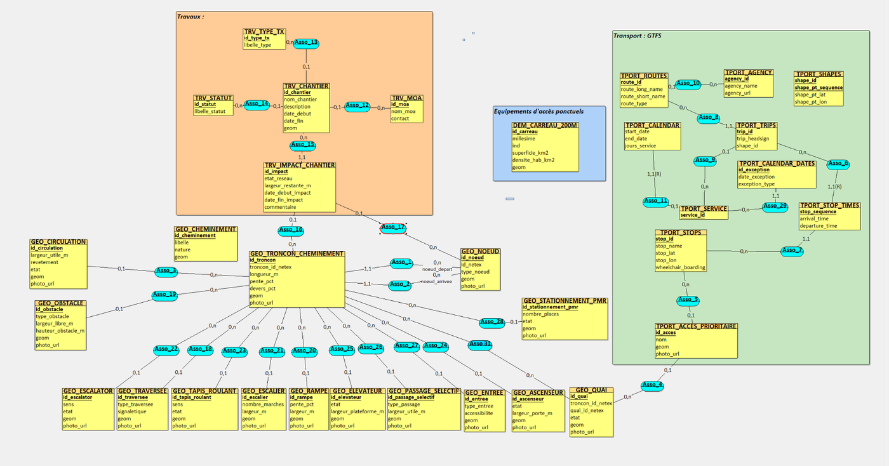
*Modèle conceptuel de données (MCD) : accessibilité CNIG, transport, travaux et contrôle qualité.*

### 3.3 Intégration et actualisation

Les données ont été importées avec **QGIS**, des scripts **SQL** et **GTFS Go**. Les modalités d'actualisation dépendent de la fréquence d'évolution de chaque jeu :

- **Accessibilité PMR** : mise à jour après une modification physique du réseau, en préservant les identifiants et les relations.
- **Travaux** : `ST_Intersects()` présélectionne les tronçons et nœuds sous l'emprise d'un chantier, puis les impacts réels sont confirmés.
- **Transport** : récupération périodique des fichiers GTFS, comparaison des versions, contrôle des correspondances entre arrêts, accès prioritaires et quais.
- **Carroyage** : intégration des nouveaux millésimes INSEE.

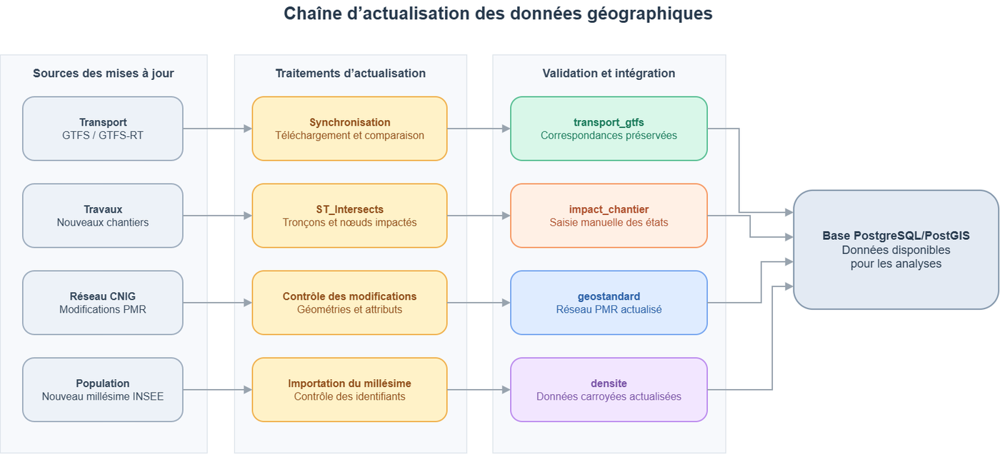
*Chaîne d'actualisation des données géographiques.*

---

## 4. Contrôle qualité des données livrées

### 4.1 Cadre : la norme ISO 19157

La démarche suit l'**ISO 19157-1**, qui distingue l'évaluation **interne** (sur les seules données livrées) de l'évaluation **externe** (confrontation à une source indépendante). Les 118 contrôles se répartissent selon les cinq éléments de qualité :

| Élément ISO 19157 | Ce qui est vérifié | Évaluation | Contrôles |
|---|---|---|---|
| Complétude | Objets manquants, attributs non renseignés, objet descriptif absent | Interne | 44 |
| Cohérence logique | Respect du modèle CNIG, listes de valeurs, géométries valides, réseau connexe | Interne | 50 |
| Exactitude de positionnement | Position des nœuds et des arrêts, altitude comparée au MNT | Interne et externe | 3 |
| Exactitude thématique | Plausibilité des largeurs, pentes et ressauts, pente comparée au MNT | Interne et externe | 10 |
| Qualité temporelle | Dates, validité de l'offre de transport, dates de chantier | Interne | 11 |

### 4.2 Un contrôle intégré au cycle de vie de la donnée

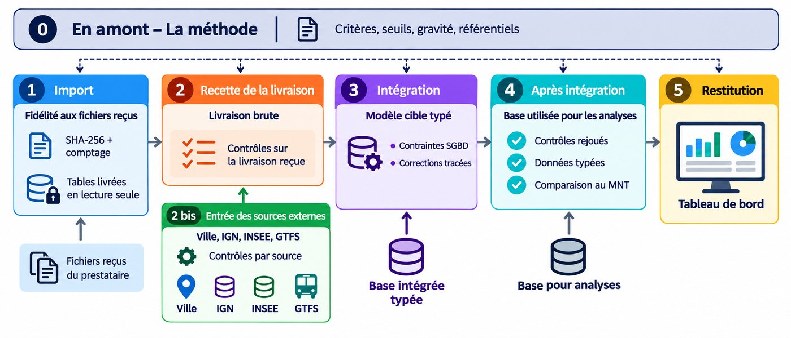
*Étapes du contrôle et nombre de contrôles exécutés.*

[Tableau de bord contrôle qualité](https://djimoyelmardo.github.io/dashbord_qualite_edc_acces/tableau_bord_qualite_supabase.html)

Deux principes structurent le dispositif :

- **La recette conditionne l'intégration** : la livraison est conservée à l'identique, en lecture seule, et toute correction intervient à l'intégration.
- **Non-destructivité** : les contrôles sont des requêtes de lecture. Seuls leurs résultats sont écrits.

Chaque contrôle est une ligne d'un **catalogue** (code, étape, élément ISO, gravité, seuil, requêtes). Les codes suivent la forme `CQ-<domaine>-<critère>-<n°>`, par exemple `CQ-GEO-COMP-08` : contrôle qualité, schéma `geostandard`, complétude, n° 8.

| Gravité | Seuil de conformité | Conséquence |
|---|---|---|
| Critique | 100 % | Refus de la livraison si non conforme |
| Majeure | 95 % | Acceptation avec réserves |
| Mineure ou information | Aucun | Documente les données |

Ces seuils sont des propositions de l'étude, à faire valider par la collectivité.

### 4.3 Contrôle externe par le MNT : pente et dévers

Le MNT d'Anglet sert de source altimétrique indépendante. Le traitement en SQL (PostGIS) reprojette les nœuds (EPSG:3943 vers EPSG:2154), lit l'altitude avec `ST_Value()`, puis calcule :

- **Pente (%)** = (différence d'altitude ÷ distance horizontale) × 100
- **Dévers (%)** = (différence d'altitude transversale ÷ distance transversale) × 100

Une **chaîne ETL** dans le Modeleur graphique de QGIS automatise le calcul à l'échelle des tronçons : 14 traitements en deux voies.

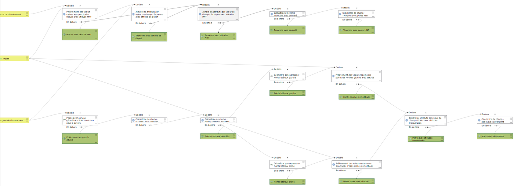
*Voie A (haut) : pente longitudinale. Voie B (bas) : dévers. Les blocs verts sont les couches de sortie.*

> **Schéma interactif de la chaîne ETL** : [ouvrir la page](https://abdou123-guene.github.io/Site_de_documentation_geomatique/etl/index.html)

| Voie | Principe | Sortie |
|---|---|---|
| A · Pente longitudinale | MNT échantillonné aux nœuds, altitudes jointes à chaque tronçon (`from` / `to`), dénivelé puis pente en % ; pente vide si la longueur est nulle ou absente | 1 184 tronçons avec dénivelé |
| B · Dévers | Points tous les 5 m (décalage de 1 m aux extrémités), deux points latéraux à 0,5 m de l'axe, écart d'altitude gauche-droite | 3 777 points de calcul du dévers |

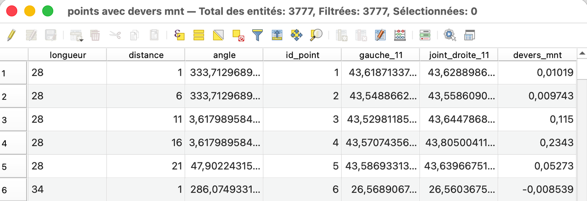
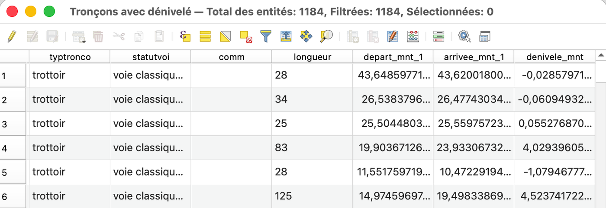

> **Limite du dévers** : le seuil réglementaire de 2 % correspond à un écart de 2 cm sur 1 m, plus petit que l'incertitude du MNT. À cette échelle, l'écart mesuré reflète surtout le bruit du modèle. Les valeurs de dévers calculées ne peuvent pas servir de mesure de contrôle. Un modèle plus précis (LiDAR HD) pourrait lever cette limite.

### 4.4 Validation du socle avant analyse

Avant tout calcul d'itinéraire, quatre contrôles successifs vérifient que les tables du réseau sont exploitables.

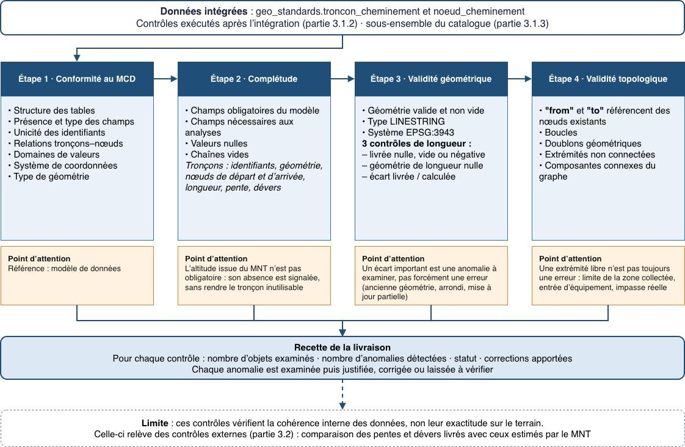
*Chaîne de validation du socle de données : conformité au MCD, complétude, validité géométrique et validité topologique.*

Une anomalie n'est pas forcément une erreur : un écart de longueur peut venir d'un arrondi ou d'une mise à jour partielle, et une extrémité libre peut marquer la limite de la zone relevée. Chaque cas est examiné et justifié. Ces contrôles vérifient la **cohérence interne**, pas l'exactitude sur le terrain.

### 4.5 Bilan de l'exécution n° 9 (30/10/2026)

| Résultat | Nombre |
|---|---|
| Contrôles conformes | 85 |
| Contrôles d'information | 13 |
| Sans objet (données absentes) | 4 |
| Non conformes | 16, dont 10 critiques |

**Un seul écart relève du prestataire** : 20 entrées sans largeur de passage. Les autres portent sur la base de travail, l'offre de transport, les travaux et la table des photos, et se corrigent sans nouvelle livraison. La livraison est acceptée **à titre provisoire, avec réserves**.

---

## 5. Analyses d'accessibilité

### 5.1 Graphe de cheminement avec pgRouting

Les tronçons deviennent les **arêtes** d'un graphe, les nœuds en sont les **sommets**. Les identifiants numériques des nœuds de départ et d'arrivée présents dans la table des tronçons sont utilisés directement comme `source` et `target`, sans rattachement spatial.

| Champ du tronçon | Identifiant numérique | Colonne pgRouting |
|---|---|---|
| `"from"` | `noeud_depart_id` | `source` |
| `"to"` | `noeud_arrivee_id` | `target` |

- La vue `geo_standards.v_troncon_pgrouting` porte l'identifiant, la source, la cible et le coût (longueur en mètres dans un premier temps).
- Pour le fauteuil roulant électrique, le coût devient un **temps de parcours** en secondes : `T = longueur × 3,6 ÷ vitesse`. Les escaliers sont exclus.
- Le réseau est traité comme bidirectionnel (`directed := false`).

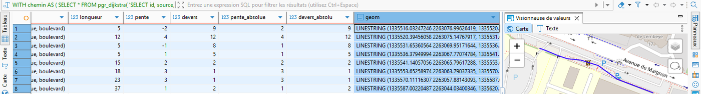
*Test du graphe avec l'algorithme de Dijkstra.*

> **Fragmentation du réseau** : le réseau compte 15 composantes connexes. La plus grande regroupe 434 nœuds sur 1 146. Un déplacement peut donc être limité par une interruption du réseau représenté, même si un cheminement existe peut-être sur le terrain.

### 5.2 Accessibilité à 5, 10 et 15 minutes en fauteuil roulant électrique

Les **accès prioritaires aux arrêts de bus** (70, dont 66 raccordables au réseau) servent de points de départ, scénario validé avec le responsable du service SIG d'Anglet.

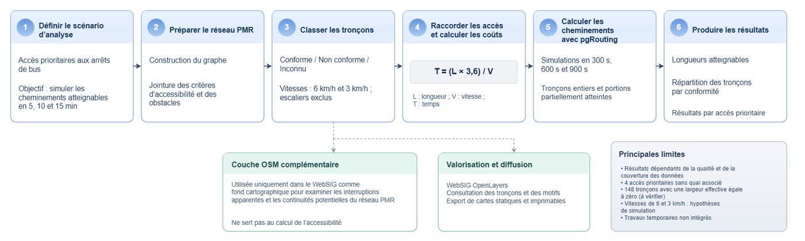

**Classification des tronçons**

| Classe | Exemples de règles |
|---|---|
| Conforme | Largeur suffisante, pente et dévers dans les limites |
| Non conforme | Pente supérieure à 5 % hors tolérance, dévers supérieur à 2 %, passage inférieur à 0,80 m, largeur inférieure à 1,20 m, ressaut supérieur à 2 cm |
| Inconnu | Pente ou largeur non renseignée, valeur 8888 |

**Vitesses** : 6 km/h (allure du pas, article R.412-34 du Code de la route), réduite à 3 km/h sur les tronçons difficiles.

| Durée | Longueur atteignable | Part du réseau PMR |
|---|---|---|
| 5 min | 15,44 km | 84,55 % |
| 10 min | 17,77 km | 97,30 % |
| 15 min | 18,10 km | 99,11 % |

Les longueurs sont calculées sans double comptage. Ce résultat mesure la couverture cumulée du graphe : il ne signifie pas qu'un seul accès permet de parcourir 99 % du réseau.

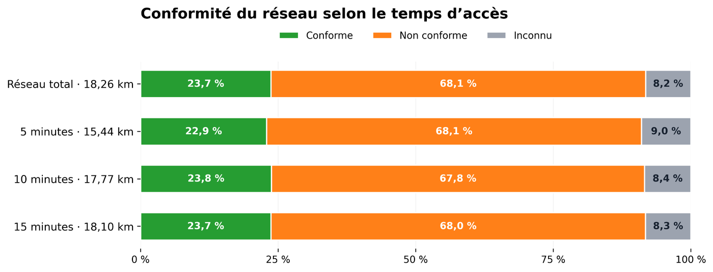
*Sur 18,26 km : 4,33 km conformes (23,69 %), 12,43 km non conformes (68,09 %), 1,50 km inconnus (8,22 %).*

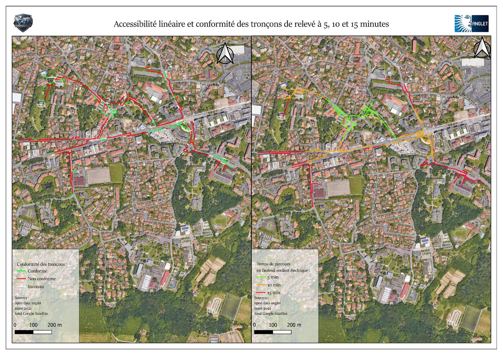
*Cheminements atteignables en 5, 10 et 15 minutes depuis un accès prioritaire, classés selon leur conformité.*

Une couche OpenStreetMap complète la carte, uniquement pour repérer des continuités possibles du réseau PMR. Une [carte interactive](https://chafiiabdi.github.io/cartes_danalyse/simulation/) permet de sélectionner un accès prioritaire.

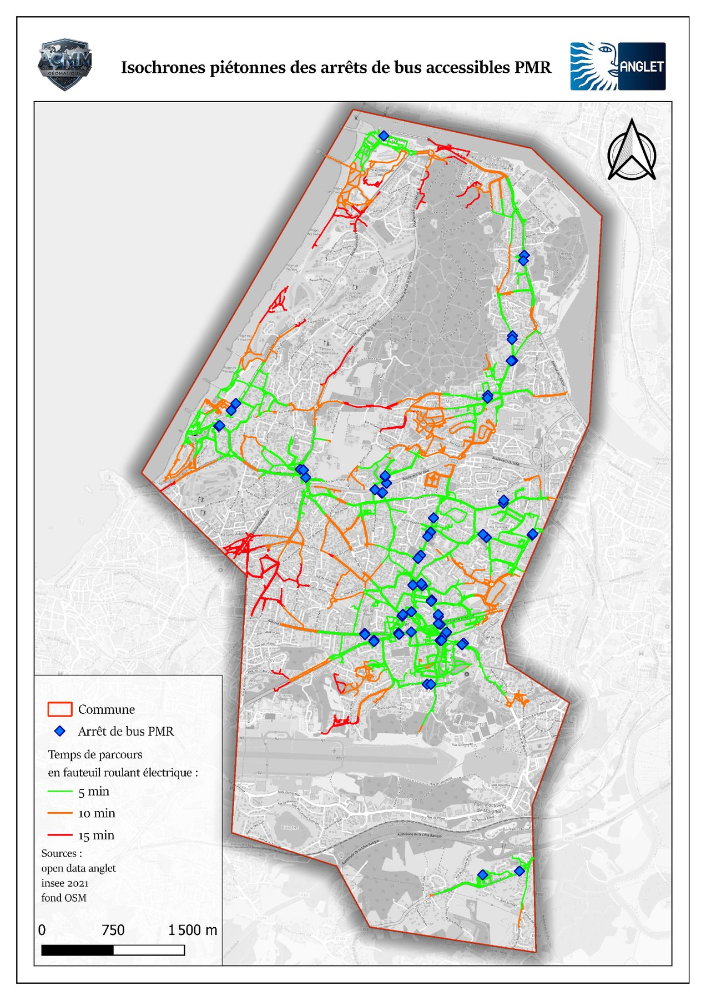

**Points de vigilance** : 4 accès prioritaires n'ont pas de quai associé, 148 tronçons (4,53 km) ont une largeur égale à zéro (à vérifier), et les vitesses sont des hypothèses de simulation.

### 5.3 Accessibilité par quartier (îlots A à H)

Le réseau CNIG est prolongé par les voies de la BD TOPO (pente estimée sur le MNT LiDAR HD) pour couvrir toute la commune. Les déplacements sont calculés depuis **12 590 adresses** de la Base Adresse Nationale vers deux jeux de destinations, selon trois hypothèses de franchissement (prudente, de référence, « tout franchissable »).

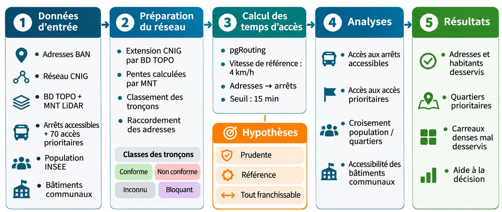

| Résultat (scénario de référence) | Valeur |
|---|---|
| Adresses à 15 min d'un arrêt déclaré accessible | 91,2 % (80,6 % à 10 min, 42,6 % à 5 min) |
| Population à 15 min d'un arrêt déclaré accessible | 92,2 %, soit environ 3 380 habitants au-delà dont 980 de 65 ans et plus |
| Adresses à 15 min d'un accès prioritaire | 66 % |
| Carreaux de forte densité et de desserte insuffisante | 39 carreaux, environ 5 819 habitants (14 % de la population) |
| Bâtiments communaux (178) | 163 à moins de 15 min d'un arrêt accessible, 136 d'un accès prioritaire |
| Accès prioritaires proches d'un bâtiment communal (64) | 8 seulement sont reliés par un cheminement entièrement conforme |

**Profils des quartiers** : les îlots A et C ont les plus fortes proportions de cheminements conformes (environ 37 %), F (8 %) et B (10 %) les plus faibles. B et E concentrent les tronçons bloquants (21 % et 17 %). G et H sont surtout contraints par la pente (près de 20 % du réseau à 5 % ou plus).

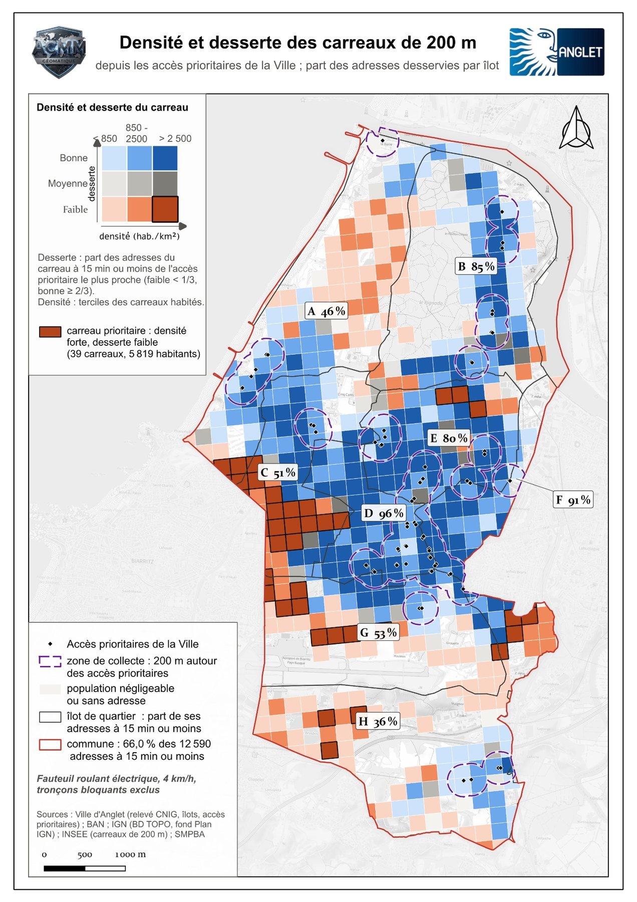

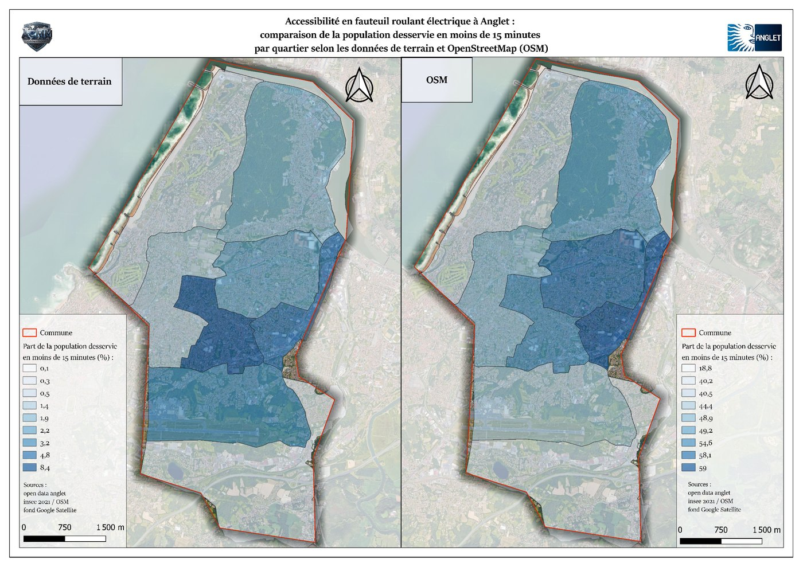

### 5.4 Priorisation des arrêts de transport

Un outil Python intégré à la boîte à outils de QGIS classe chaque arrêt à partir d'un rayon de 200 m, selon deux scores :

- **Score de demande** : 70 % population dans le rayon, 30 % nombre de lignes.
- **Score d'accessibilité** : distance au cheminement (seuils de 5, 10, 20, 30 et 50 m), obstacles, déficits en tronçons et en nœuds, déficit d'accessibilité PMR.

Le score final est la **moyenne géométrique** des deux scores : un arrêt doit présenter à la fois un enjeu de demande et un enjeu d'accessibilité pour obtenir un score élevé.

| Score final | Priorité |
|---|---|
| 75 ou plus | Très haute |
| 55 à 74 | Haute |
| 35 à 54 | Moyenne |
| Moins de 35 | Faible |

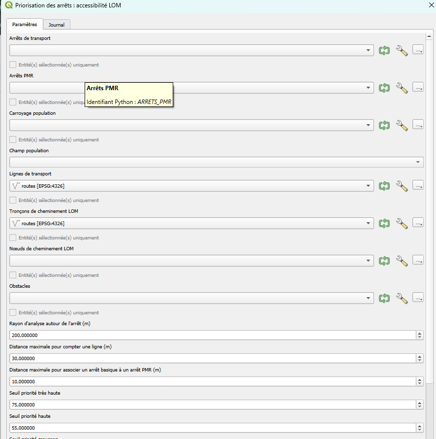

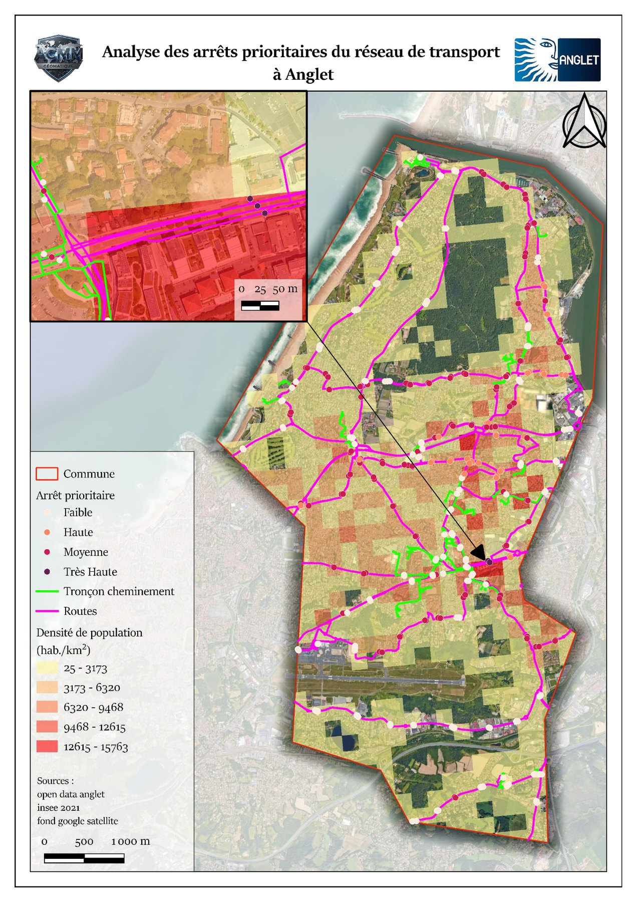

---

## 6. Études prospectives : IA et aménagements

### 6.1 Faisabilité de la détection par IA

Objectif : assister le **contrôle qualité** et la **mise à jour** des données (passages piétons, mobilier urbain, obstacles), jamais remplacer la validation humaine. Les performances sont mesurées avec la **précision** `P = TP / (TP + FP)` (absence de fausses alarmes) et le **rappel** `R = TP / (TP + FN)` (absence d'omissions).

| Famille testée | Outil | Statut |
|---|---|---|
| Traitement d'image classique | GDAL, NumPy, SciPy | Mesuré sur passages piétons connus |
| Machine learning classique | Random Forest | Écarté (inadapté à la localisation) |
| Modèle de fondation | SAM 3 | Utilisé pour pré-annoter le jeu d'apprentissage |
| Saisie assistée | Geo-SAM | Non retenu (intervention humaine continue) |
| Segmentation supervisée | U-Net (ResNet-50) | Utilisé pour l'inventaire communal |
| Détection supervisée | **YOLOv8n** (AGPL-3.0) | Retenu pour le prototype sur le PCRS |

**Résultats par expérience**

| Expérience | Résultat |
|---|---|
| Passages piétons connus (235 vignettes) | Détecteur classique : précision 93 %, rappel 95 %. SAM 3 : précision 95 %, rappel 99 % |
| Changements 2022-2025 | 17 changements distincts identifiés (SAM 3 : 22 alertes, 16 confirmées) |
| Inventaire communal avec U-Net | 1 534 passages potentiels, dont 321 absents des références ; précision estimée à 91 % (98 % pour les passages connus, 64 % pour les nouveaux) |
| Mobilier urbain, photos de rue (Panoramax) | Bancs : précision 71 %, rappel 57 % ; stationnements vélo : 73 % et 63 % ; position estimée à environ 2,2 m |
| Obstacles verticaux | 236 examinés, 111 triangulés, 12 obstacles à vérifier sur le terrain |
| YOLOv8n sur PCRS | Précision 1,00, rappel 0,918, mAP@50 0,95, mAP@50-95 0,855 |

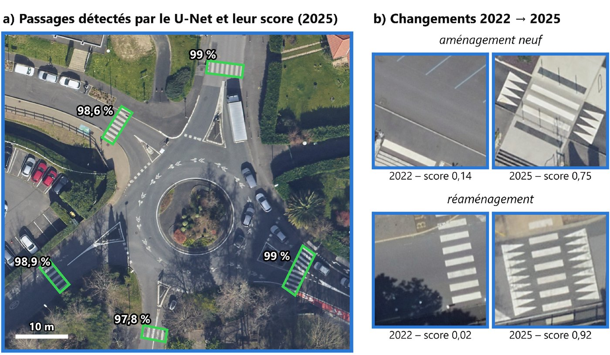

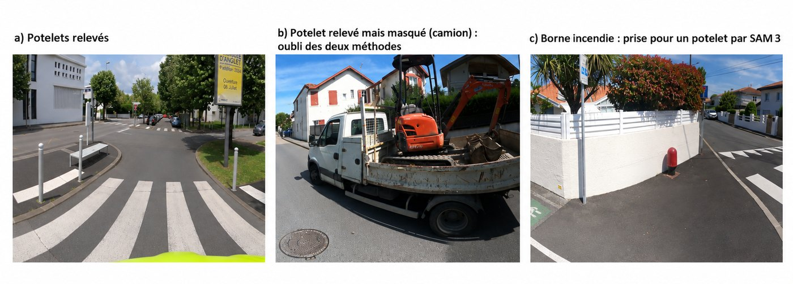

**Chaîne YOLOv8n en trois scripts Python** : (1) préparation du jeu d'apprentissage (tuiles de 640 × 640 px, annotations au format YOLO), (2) entraînement (100 époques, lot de 8), (3) détection par tuiles (seuil de confiance 0,40) et export GeoPackage.

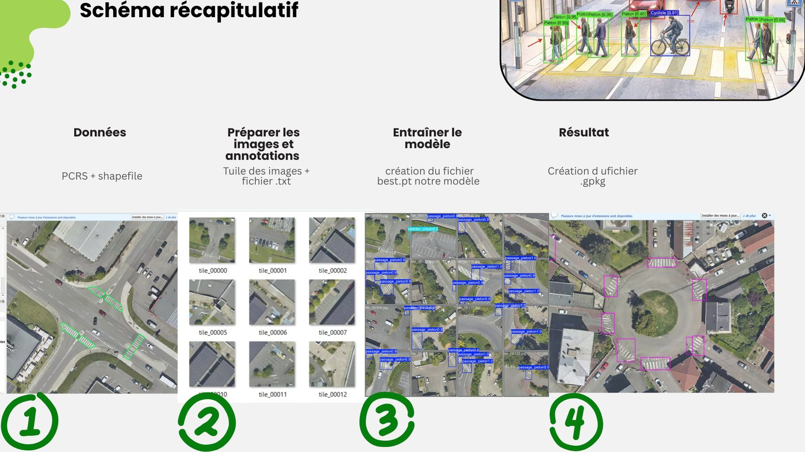
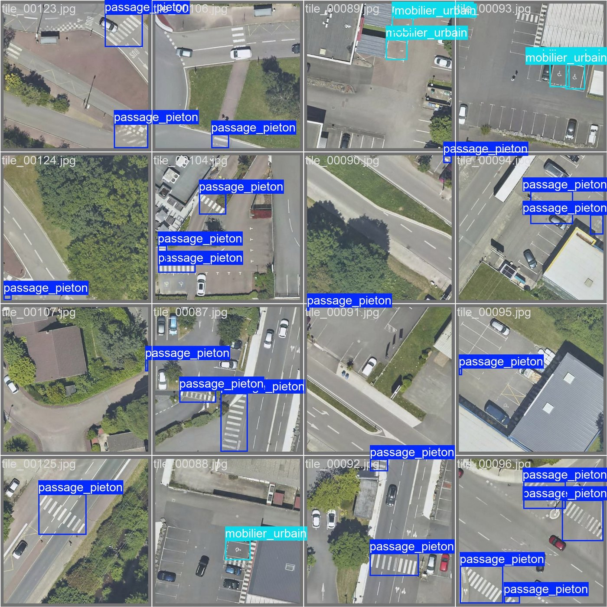

> **Lecture prudente des résultats** : les indicateurs de YOLOv8n sont mesurés sur les données de validation utilisées pendant l'entraînement. Ils prouvent la faisabilité, pas la capacité de généralisation : une évaluation sur un jeu de test indépendant reste nécessaire. Le modèle confond aussi des piscines bleues avec des places PMR.

### 6.2 Identification et simulation d'aménagements

Un traitement automatisé compare le réseau existant (`geo_standards.v_troncon_pgrouting`) aux tronçons candidats et repère les raccordements possibles avec `ST_Distance`, `ST_DWithin` et `ST_ClosestPoint`. Il s'exécute avec un **script Python**, un **fichier batch** et le **Planificateur de tâches de Windows**.

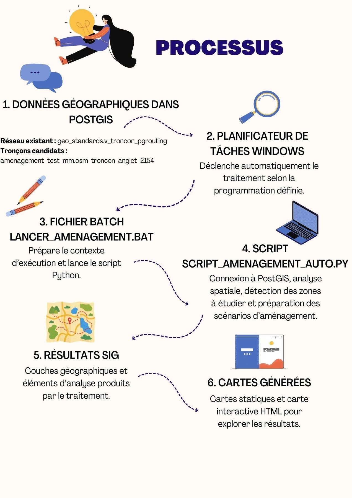

| Scénario | Description |
|---|---|
| 0 · Réseau existant | Situation initiale et discontinuités |
| 1 · Raccordements ponctuels | Connexions entre tronçons candidats et réseau existant |
| 2 · Extension du réseau | Intégration de nouveaux tronçons |
| 3 · Aménagements ciblés | Interventions sur des zones prioritaires |

> Les propositions sont des **pistes d'intervention** : la proximité de deux tronçons ne garantit pas qu'un raccordement soit praticable. Une vérification sur le terrain (pente, largeur, revêtement, bordures, obstacles) reste nécessaire.

---

## 7. Diffusion et solution web

### 7.1 Portail open data, catalogue et NeTEx

Le dépôt NeTEx est imposé par la réglementation (arrêté du 28 mai 2024). Trois familles de catalogues ont été comparées (GeoNetwork, CKAN ou uData, Opendatasoft). **Préconisation** : faire de **geOrchestra** la source de diffusion (GeoServer pour les services, GeoNetwork pour les fiches), avec Opendatasoft comme vitrine grand public.

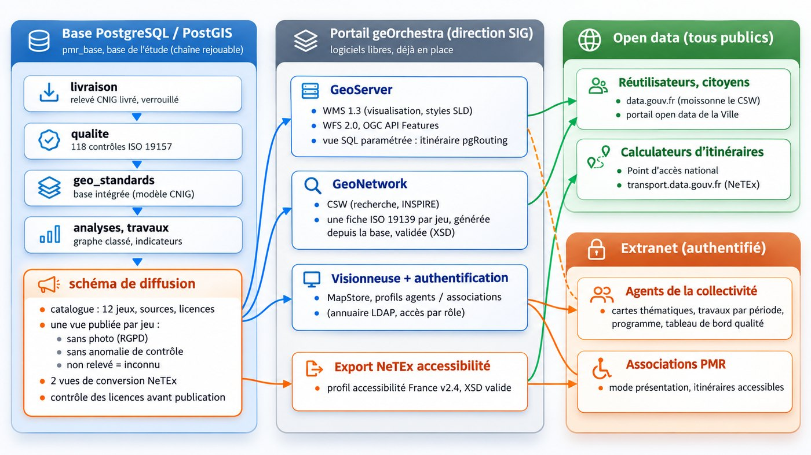
*Une base, trois canaux (catalogue, services, Point d'accès national) et deux publics (open data, extranet).*

[Prototype de l'application PMR sur la démonstration](http://djimoyelmardo.github.io/dashbord_qualite_edc_acces/prototype)

- La base n'est jamais exposée directement : tout passe par des **vues de diffusion** (aucune photographie, aucune anomalie de contrôle, valeur non relevée publiée comme « inconnue »).
- Le catalogue compte **12 jeux** (9 open data, 3 extranet). Les fiches **ISO 19139** sont générées depuis la base, avec le rapport qualité ISO 19157.
- **Export NeTEx** des 1 184 tronçons : 277 accessibles, 658 accessibles avec difficulté, 140 inaccessibles, 109 inconnus. Un tronçon non mesuré est déclaré `unknown`, jamais accessible.

### 7.2 SIG web extranet et calcul d'itinéraires

Quatre solutions ont été comparées : geOrchestra seul, Lizmap, geOrchestra avec une application PMR dédiée (**solution retenue**) et un service hébergé propriétaire (exclu, car non libre).

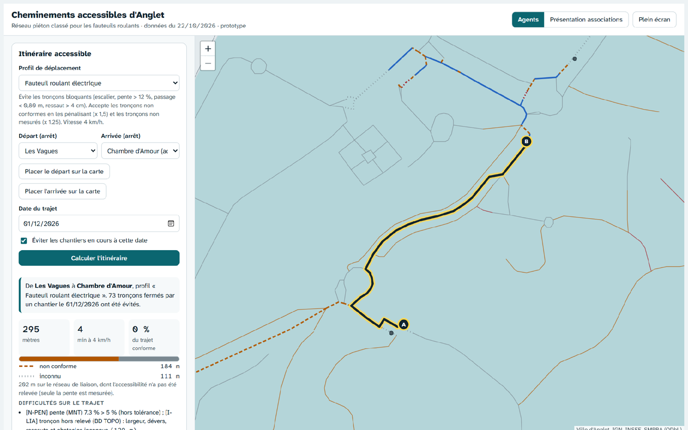

Le prototype propose le réseau classé, un **itinéraire selon sept profils** de déplacement, les travaux sur une période, dix cartes thématiques et deux modes de consultation (agents, présentation aux associations). Le calcul s'appuie sur l'algorithme de Dijkstra de pgRouting, publié en vue SQL paramétrée via GeoServer. Temps de réponse mesuré : de 0,03 à 0,11 s.

### 7.3 Accessibilité numérique, conformité et données personnelles

- **RGAA 4.1.2** : le taux de conformité ne peut être établi que par un audit, prévu au chiffrage. Le prototype est conçu en vue de cet audit (alternative textuelle, formulaires étiquetés, navigation au clavier).
- **INSPIRE** : métadonnées et services en réseau remplis, sans revendiquer une conformité de schéma non vérifiée.
- **RGPD** : les recherches d'itinéraires selon un profil de mobilité peuvent révéler des informations sensibles. Le journal d'accès du serveur doit être réglé pour ne plus conserver ces paramètres.

---

## 8. Conclusion et recommandations

Le relevé d'Anglet ne couvre qu'une partie de la voirie : 13 % de la commune, et 15,8 km des 57,8 km de voirie à l'intérieur de cette zone. Un cinquième seulement du linéaire relevé est conforme, le dévers étant la principale difficulté. Trois priorités se dégagent :

1. **Étendre les relevés** dans les quartiers les moins bien desservis (les îlots H, A, C et G).
2. **Cibler les aménagements** sur les obstacles et les liaisons vers les équipements publics.
3. **Associer les personnes à mobilité réduite** à la validation des solutions proposées.

La chaîne de traitement est reproductible, fondée sur des standards ouverts et transposable à d'autres territoires. La mise en production et les validations complémentaires relèvent de l'activité A4.

---

## 9. Limites et points de vigilance

| Sujet | Limite |
|---|---|
| Couverture du relevé | 13 % de la commune seulement : les résultats hors zone relevée sont des estimations |
| Fragmentation du réseau | 15 composantes connexes : une faible portée d'un accès peut venir d'un manque de connexion dans les données |
| Dévers | Non contrôlable avec le MNT actuel (2 cm sur 1 m) |
| Seuils de qualité | Propositions à valider par la collectivité |
| IA | Résultats de faisabilité : pas d'évaluation sur un jeu de test indépendant, validation humaine nécessaire |
| Aménagements | Simulation géométrique : ni certification PMR, ni validation technique |
| Diffusion | Validation de sécurité complète, audit RGAA et validateurs nationaux à réaliser avant mise en production |

---

## 10. Scripts, reproductibilité et ressources

Les traitements sont entièrement scriptés (SQL, Python) et rejouables. Écriture en base en une seule transaction, avec des étapes d'essai qui simulent puis annulent.

| Domaine | Contenu |
|---|---|
| Contrôle qualité | Catalogue de contrôles, fonction `qualite.executer_controles()`, tableau de bord HTML |
| Analyse par quartier | Classement des tronçons, calculs pgRouting depuis les adresses, indicateurs par îlot, IRIS et carreau |
| Intelligence artificielle | Détection (SAM 3, U-Net, YOLOv8n), inventaire et figures |
| Diffusion | Schéma `diffusion`, export NeTEx, fiches ISO 19139, prototype web, pile Docker de démonstration |

**Environnement** : QGIS 3.44, PostgreSQL avec PostGIS et pgRouting, Python (PyTorch pour U-Net), Docker (PostgreSQL 18, GeoServer 2.28, GeoNetwork 4.4.12).

**Ressources en ligne**

- [Schéma interactif de la chaîne ETL](https://abdou123-guene.github.io/Site_de_documentation_geomatique/etl/index.html)
- [Carte interactive des cheminements atteignables](https://chafiiabdi.github.io/cartes_danalyse/simulation/)
- [Script SQL du MCD CNIG](https://github.com/jmtrivial/OSM-vers-geostandardCNIG/blob/main/postgis/geostandard-CNIG.sql)

---

## 11. Sources, licences et remerciements

**Sources** : données d'accessibilité d'Anglet (data.gouv.fr, Licence Ouverte 2.0), GTFS du Syndicat des Mobilités Pays Basque-Adour (ODbL), carroyage INSEE (Licence Ouverte 2.0), Base Adresse Nationale, BD TOPO et LiDAR HD de l'IGN, PCRS de Limoges Métropole (accès restreint).

**Remerciements** : Ville d'Anglet, notamment Christophe Harnie et Adrien Mittau-Dupreuilh ; Limoges Métropole, notamment Aurélie Bordas ; Syndicat des Mobilités Pays Basque-Adour ; INSEE ; sociétés de relevé (ADERA, ACCECIA, AG CARTO, ARCATHEME, AXESIG) ; Cécilia Leduc et l'équipe pédagogique de l'IDGEO.

> Document de synthèse tiré du rapport final de l'étude de cas A3. Les résultats présentés sont des propositions à valider et ne constituent pas une certification d'accessibilité.
